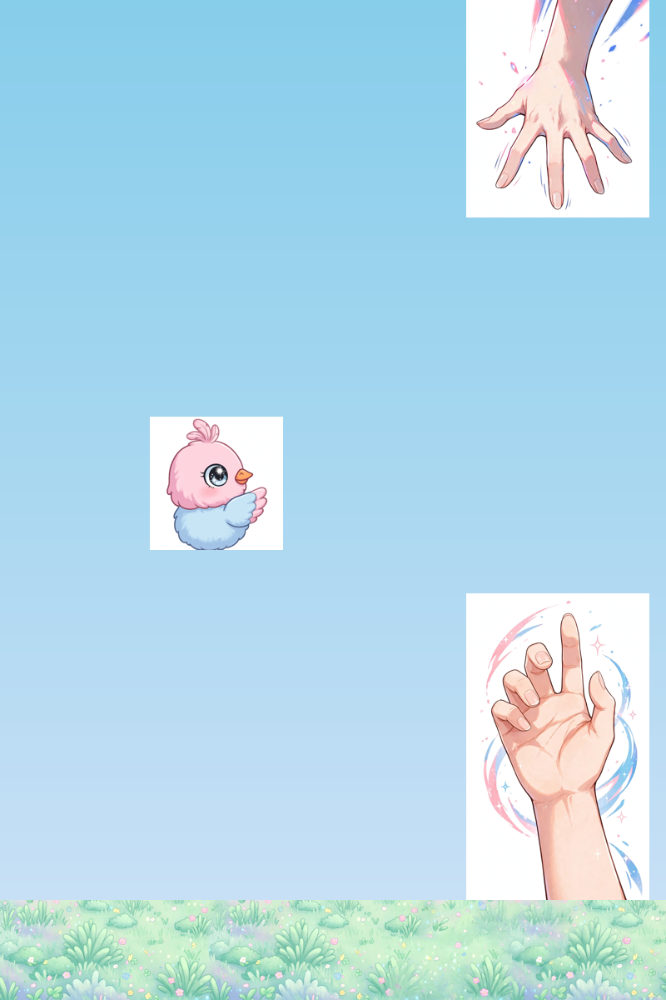

# Open Flappy

Flappy Bird 换皮整蛊小游戏完整方案：网页版 + Android App + 批量生成工作台。上传图片、填表单，一键生成专属整蛊游戏。



## 包含什么

```
open-flappy/
├── game/       # 网页版（单文件 Canvas 游戏）
├── android/    # Android App（WebView 跑同一套代码，纯离线）
└── studio/     # Cloudflare Worker 批量生成工作台
```

- **game/**：`index.html` 单文件，粉蓝萌系美术，代码里留了"换皮区"，换图片改文案就能定制。
- **android/**：WebView 加载本地 `assets/www/`，玩法与网页版一致，零权限、纯离线。
- **studio/**：Worker + KV，网页表单填配置、传素材，生成 `https://your-studio.example.com/g/<代号>/` 专属链接。

## 快速开始

### 网页版

直接用静态托管部署 `game/` 目录即可（Cloudflare Pages / GitHub Pages）。

### App

```bash
cd android
./gradlew assembleDebug
```

包名 `com.example.flappydot`，应用名 `xx快跳`，自行修改。

### 工作台

```bash
cd studio
# 建 KV namespace，ID 填进环境变量 CF_KV_NAMESPACE_ID
# 默认素材放 default-assets/，跑 seed.py 灌进 KV
python3 seed.py
python3 deploy.py
```

环境变量：`CF_ACCOUNT_ID`、`CF_API_TOKEN`、`CF_KV_NAMESPACE_ID`。

## 换皮

`game/index.html` 搜索"换皮区"：换 `assets/` 下的图片、改标题/结算文案即可。默认主角是一只通用小鸟，障碍物是去掉了配饰的通用卡通手。

MIT License.
